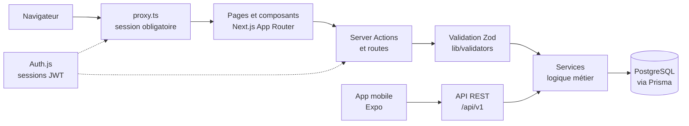
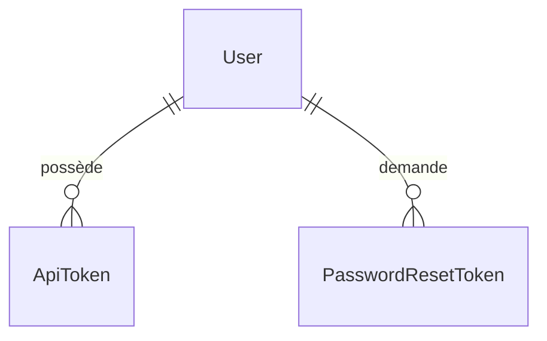

# Architecture de TemkiLab

> À compléter : décris ici ce que fait **ton** application et pourquoi elle est construite ainsi.

## Vue d'ensemble

Chaque requête traverse les mêmes couches. Règle d'or : les pages et les actions serveur ne parlent **jamais**
directement à la base, elles passent par un **service** (`src/services`), qui contient la logique métier et
contrôle les droits.



## Organisation du dépôt

```
src/
├─ app/            Pages (App Router)
│  ├─ (auth)/      Connexion, inscription, mot de passe oublié / réinitialisation
│  ├─ (app)/       Espace connecté : dashboard, profile, settings (layout commun avec barre de navigation)
│  ├─ api/v1/      API REST (mobile) : auth/token, me, me/avatar, openapi.json
│  ├─ api-docs/    Documentation lisible de l'API
│  ├─ legal/       Confidentialité et mentions légales (à compléter)
│  ├─ offline/     Page affichée sans réseau (service worker)
│  └─ page.tsx     Page vitrine
├─ components/     Composants partagés (ui/ = base shadcn)
├─ i18n/           Traductions FR / EN / DE (voir I18N.md)
├─ lib/            Auth, validation, rate limit, API, utilitaires
├─ services/       Logique métier (la seule couche qui parle à Prisma)
└─ proxy.ts        Protection des routes (session obligatoire)
prisma/            Schéma, migrations, jeu de démonstration
mobile/            Application Expo / React Native
public/sw.js       Service worker (page hors ligne)
```

## Ce que le template fournit déjà

| Domaine    | Contenu                                                                                                   |
| ---------- | --------------------------------------------------------------------------------------------------------- |
| Comptes    | Inscription, connexion (Auth.js, JWT), mot de passe oublié par e-mail, changement de mot de passe         |
| Sécurité   | Limitation des tentatives (par e-mail et par IP), redirections sûres, CSP et en-têtes de sécurité         |
| RGPD       | Export des données (JSON), suppression de compte par anonymisation, purge des données techniques expirées |
| Profil     | Nom, photo (réduite à 256 px), préférences (langue, thème, retour haptique) synchronisées sur le compte   |
| PWA        | Manifeste, icônes générées, service worker, page hors ligne                                               |
| API mobile | Jeton révocable (haché en base), lecture par cookie, écriture par jeton uniquement (anti-CSRF)            |

## Modèle de données

Modèles de départ (`prisma/schema.prisma`) : `User`, `ApiToken`, `PasswordResetToken`, `RateLimit`.
Ajoute les tiens à la suite, puis `npm run db:migrate`.



## Ajouter une fonctionnalité (marche à suivre)

1. **Modèle** : ajouter le modèle dans `prisma/schema.prisma`, puis `npm run db:migrate`.
2. **Service** : `src/services/xxx.service.ts` — logique métier et contrôle des droits.
3. **Validation** : schéma Zod dans `src/lib/validators/` (les messages d'erreur sont des clés i18n).
4. **Interface** : page dans `src/app/(app)/xxx/` + Server Actions ; textes dans `src/i18n/messages/`.
5. **API mobile** : route dans `src/app/api/v1/`, enveloppée par `withUser`, décrite dans `src/lib/openapi.ts`.
6. **Mobile** : fonction dans `mobile/src/api/client.ts`, écran dans `mobile/src/app/`.
7. **Suppression de compte / export** : compléter `src/services/account.service.ts` si le modèle est lié à `User`.
8. **Tests** : service (`tests/integration`), règles pures (`src/**/*.test.ts`), parcours (`e2e/`).
